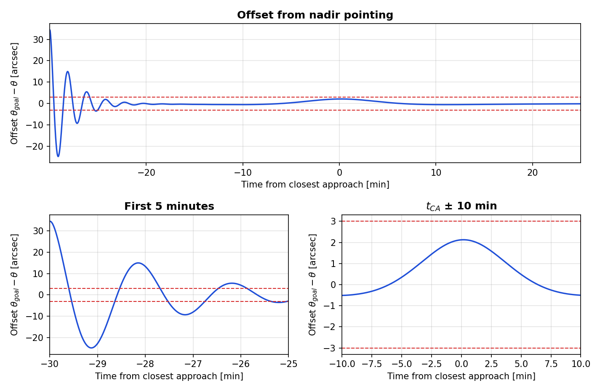
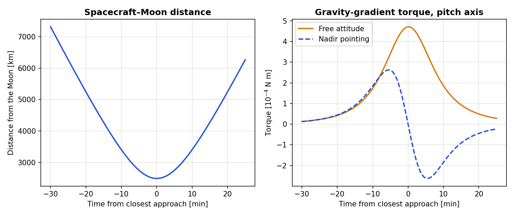
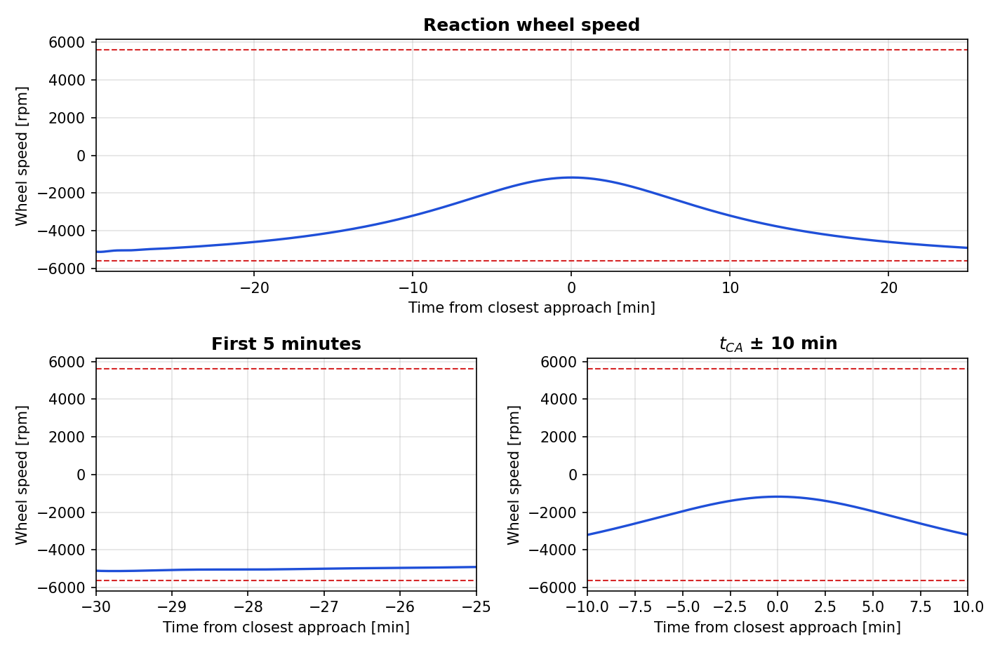
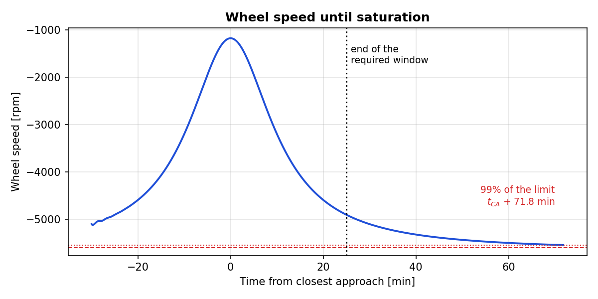
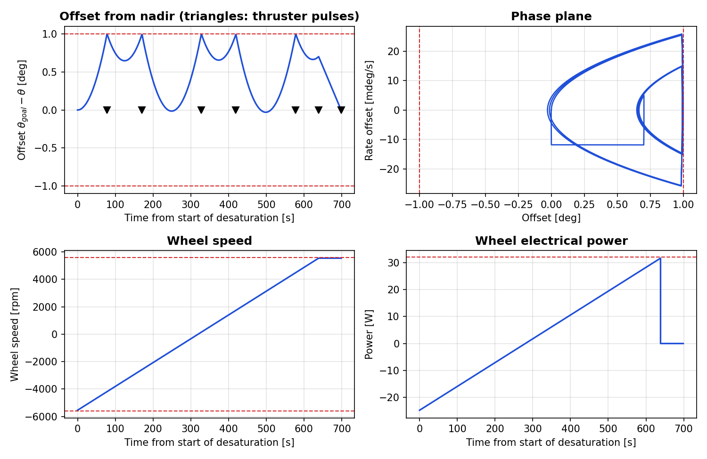

# Nadir-Pointing Pitch Control of JUICE during its Lunar Flyby

MATLAB design of the pitch attitude control of **JUICE** during the lunar flyby of the
Lunar–Earth Gravity Assist (LEGA, August 2024). A reaction wheel keeps the body Z-axis on
the Moon within **3 arcsec** from 25 minutes before to 25 minutes after closest approach;
thrusters desaturate the wheel when its speed approaches the limit.



## Highlights

- **Nadir reference from the orbit**: with the pitch angle measured from the velocity vector,
  nadir pointing means $\theta_{goal} = \arccos\left(\frac{\mathbf r\cdot\mathbf v}{rv}\right) - \frac{\pi}{2}$,
  differentiated exactly along the Keplerian motion. The initial attitude of the problem is
  nadir pointing to 34 arcsec.
- **PID on the reaction wheel** with an automatic gain search: $k_p$ starts from the value
  that balances the peak gravity gradient at the tolerance and grows until every requirement
  is met, giving $k_p$ = 238 N m/rad, $k_d$ = 8659 N m s/rad, $k_i$ = 23.55 N m/(rad s).
  The offset is within 3 arcsec after 299 s (requirement: 300 s).
- **Actuator budget**: torque ≤ 0.051 N m, power ≤ 5.5 W, wheel speed between −5117 and
  −1172 rpm, all well inside the limits.
- **Window extension**: with the same control law the window can be extended by
  **46.8 minutes**, up to tCA + 71.8 min, when the wheel reaches 99% of its limit. The momentum
  budget shows that saturation is caused by the despin of the nadir-tracking rate, not by
  the gravity gradient.
- **Desaturation**: wheel driven from −5544 to +5544 rpm at maximum torque, with 1 s thruster
  pulses whose trigger keeps the offset below 1°, followed by a two-pulse slew that hands
  the attitude back to the wheel in 62 s. The power peaks at 31.6 W, just below the 32 W limit.

## Problem setup

| Item | Value |
|------|-------|
| Orbit | Moon monopole gravity, planar hyperbola, closest approach at 2488 km (750 km altitude) |
| Epoch | tCA − 30 min: x = 6734.4548 km, y = −2868.0095 km, u = −3.805775 km/s, v = 0.093497 km/s |
| Attitude | θ = 68.33°, θ̇ = −0.0105 °/s, θ measured from the velocity vector to the body X-axis |
| Inertia | Ix = 36 000, Iy = 35 000, Iz = 37 000 kg m² |
| Wheel | Iw = 0.11 kg m², initial −5100 rpm, limits ±5600 rpm and ±0.2 N m, P ≤ 32 W |
| Motor | Km = 0.118 N m/A, Kw = 0.003 V/rpm, R = 1.2 Ω |
| Thrusters | two pairs of 10 N at 1.25 m (25 N m per pair), minimum pulse 0.01 s |
| Requirement | body Z-axis on nadir within 3 arcsec from tCA − 25 min to tCA + 25 min |

## Model

Nadir pointing puts the body X-axis on the local horizontal, so the reference is set by the
angle between position and velocity:

$$
\theta_{goal} = \arccos s - \frac{\pi}{2}, \qquad s = \frac{\mathbf r\cdot\mathbf v}{rv}, \qquad
\dot\theta_{goal} = -\frac{\dot s}{\sqrt{1-s^2}}
$$

where $\dot s$ is computed exactly from position, velocity and gravitational acceleration.
The linearised pitch dynamics, the wheel and its electrical model are

$$
I_y\ddot\theta = G_y + T_c, \qquad I_w\dot\omega_w = -T_c, \qquad
G_y = \frac{3\mu}{2r^3}(I_z-I_x)\sin 2\theta\cos\varphi
$$

$$
i_w = \frac{T_m}{K_m}, \qquad P_w = (K_w\,\omega_w + R\,i_w)\,i_w, \qquad T_m = -T_c
$$

where $T_m$ is the torque the motor applies to the wheel, so that $K_w\omega_w i_w$ is the
mechanical power and $P_w < 0$ means regeneration. The control law is a PID on the offset
$e = \theta_{goal} - \theta$:

$$
T_c = k_p\,e + k_d\,\dot e + k_i\!\int e\,dt, \qquad |T_c| \le 0.2\ \text{N m}
$$

The orbit and the attitude are integrated together (`ode113`, tolerances 10⁻¹²).
The roll angle stays at zero: with φ = 0 and the principal axes in the orbital frame there
is no gravity-gradient torque on the roll axis.

## Results

### Task 1 – Gravity-gradient torque



Without control the spacecraft keeps rotating at about −0.0105 °/s and the torque peaks at
**4.72·10⁻⁴ N m** at closest approach. This peak sets the starting point of the gain search.
For comparison, along the nadir-pointing attitude the torque peaks at 2.63·10⁻⁴ N m
5.5 minutes before and after closest approach and changes sign at tCA, where r ⊥ v.

The state uncertainty given by Flight Dynamics (0.2 m, 1 mm/s) maps into at most
**0.15 arcsec** (1σ) on the nadir reference, 5% of the pointing tolerance.

### Task 2 – PID design

The derivative gain is 1.5 times the critical value of the PD pair,
$k_d = 1.5 \cdot 2\sqrt{k_p I_y}$, and the integral gain is 40% of the Routh–Hurwitz limit
of $I_y s^3 + k_d s^2 + k_p s + k_i$, i.e. $k_i = 0.4\,k_p k_d/I_y$. The integral action
is needed because the reference accelerates near closest approach. The search starts from
$k_p = \lceil G_{max}/\theta_{tol}\rceil = 33$ and increases $k_p$ in steps of 5 until the
pointing, wheel-speed, torque and power requirements are all met: 42 simulations give
**kp = 238**.

| Quantity | Max during the window | Limit |
|----------|-----------------------|-------|
| Pointing offset (after tCA − 25 min) | 2.83 arcsec | 3 arcsec |
| Pointing offset (tCA ± 10 min) | 2.12 arcsec | 3 arcsec |
| Wheel torque | 0.051 N m | 0.2 N m |
| Wheel speed | −5117 to −1172 rpm | ±5600 rpm |
| Motor current | 0.43 A | – |
| Electrical power | 5.5 W (min −3.3 W, regenerative) | 32 W |

The closed-loop poles are −0.231 and −0.0084 ± 0.0534i s⁻¹: the integral term moves the
dominant pair to a damping of **0.16** (period 118 s), which explains the oscillating
transient although the PD pair alone is overdamped.



The wheel absorbs the angular momentum needed to follow the nadir rate, which peaks at
closest approach. Rate offset, torque, current and power, each with the two zooms
required by the assignment, are in [`figures/`](figures/).

### Task 3 – Extension of the pointing window



With the same control law the offset stays below 3 arcsec until the wheel reaches 99% of
its limit (−5544 rpm) at **tCA + 71.8 min** (r = 16 400 km): the nadir-pointing window can be
extended by **46.8 minutes** beyond tCA + 25 min, and the desaturation must start then.
The 1% margin matters: the wheel approaches its limit slowly and would reach −5600 rpm only
at tCA + 102.3 min.

| Angular momentum change, epoch → saturation | N m s |
|---------------------------------------------|-------|
| Spacecraft, $I_y\Delta\dot\theta$ | +5.106 |
| Wheel, $I_w\Delta\omega_w$ | −5.115 |
| Gravity-gradient impulse, $\int G_y\,dt$ | −0.008 |

The gravity-gradient impulse almost cancels because the torque changes sign at closest
approach. The wheel saturates because, moving away from the Moon, the nadir rate decreases
towards zero and the spacecraft momentum is transferred to the wheel, which started only
500 rpm from its limit.

### Task 4 – Desaturation manoeuvre



To maximise the interval to the next desaturation the wheel is driven to the **opposite
limit** (99%), so that the whole speed range is available for the momentum build-up:

1. **Spin-up**: the PID is switched off and the motor drives the wheel at the maximum torque
   (0.2 N m) for 639 s. The reaction torque makes the offset grow with constant acceleration;
   when it reaches 0.99° the positive thruster pair fires a 1 s pulse (25 N m s) that pushes
   it back.
2. **Hand-over**: at +5544 rpm the wheel torque is removed and a two-pulse slew, with
   durations in multiples of the 0.01 s minimum pulse, brings offset and rate back to zero
   in 60 s. Without it the PID would take over with a 0.7° offset, saturate its torque and
   drive the wheel back to its limit in about 4 minutes.

| Pulse | t − tCA [min] | Duration [s] | Pair | Purpose |
|-------|---------------|--------------|------|---------|
| 1 | 73.08 | 1.00 | + | deadband |
| 2 | 74.63 | 1.00 | + | deadband |
| 3 | 77.25 | 1.00 | + | deadband |
| 4 | 78.78 | 1.00 | + | deadband |
| 5 | 81.42 | 1.00 | + | deadband |
| 6 | 82.43 | 0.41 | + | start of the final slew |
| 7 | 83.43 | 0.29 | − | end of the final slew |

The manoeuvre lasts 699 s and moves 127.7 N m s from the wheel to the thrusters, with the
offset between −0.03° and 0.998°. The power reaches **31.6 W** at the end of the spin-up,
against a limit of 32 W: the maximum wheel torque is usable only because the target speed
stays below 5600 rpm. After the hand-over the offset is back within 3 arcsec in 62 s, and
over the next 24 hours the wheel only drifts from +5544 to +5455 rpm: within this model no
further desaturation is needed, and the next one is driven by disturbances that are not
modelled here.

## Limitations and possible improvements

- **Small margins**: kp = 238 is the first gain of the search that meets the requirement,
  so the offset enters the 3 arcsec band only 1 s before it is required; the 1 s pulses
  fired at 0.99° let the offset peak at 0.998°. A larger kp and pulses sized to use the
  whole ±1° band would give the same results with margin and fewer pulses.
- **Planar, decoupled pitch dynamics**, as prescribed by the assignment. With θ measured from
  the velocity vector, the equation neglects the rotation of the velocity direction, and the
  gravity-gradient formula uses θ instead of the angle from the local vertical, which would
  give zero torque at exact nadir pointing.
- **Ideal actuators and sensors**: no wheel friction or stiction (the wheel crosses zero speed
  during the desaturation), no thruster misalignment, no attitude-determination error.
- **Disturbances limited to the gravity gradient of the Moon**: solar radiation pressure and the
  Earth flyby two days later would set the actual interval between desaturations.

## Repository structure

```
├── main.m                          # Tasks 1-4: results printed in the Command Window
└── functions/
    ├── mission_parameters.m          # problem data in SI units
    ├── closest_approach.m            # time and radius of the pericentre (hyperbolic Kepler)
    ├── nadir_reference.m             # theta_goal and its exact time derivative
    ├── pointing_offset.m             # offset and rate offset from nadir
    ├── gravity_gradient.m            # pitch gravity-gradient torque
    ├── pitch_pid_dynamics.m          # orbit + pitch + wheel with PID control
    ├── pitch_open_dynamics.m         # orbit + pitch with prescribed wheel/thruster torques
    ├── pid_gains.m, pid_torque.m     # gains from kp and control torque
    ├── tune_gains.m                  # incremental search on kp with all the requirements
    ├── simulate_pid.m                # closed-loop simulation, torque, current and power
    ├── wheel_electrical.m            # current and power
    ├── saturation_event.m            # wheel speed limit
    ├── desaturation_manoeuvre.m      # spin-up with thruster pulses + final slew
    └── plot_with_zooms.m, save_figure.m
```

## How to run

Requires MATLAB R2020a or later, no toolboxes. Run `main.m`: the results of the four tasks
are printed in the Command Window. Set `SAVE_FIGURES = true` to export the plots to
`figures/`. The gain search runs 42 closed-loop simulations and can take a few minutes.

## References

- M. J. Sidi, *Spacecraft Dynamics and Control: A Practical Engineering Approach*,
  Cambridge University Press, 1997.
- F. L. Markley, J. L. Crassidis, *Fundamentals of Spacecraft Attitude Determination and
  Control*, Springer, 2014.

## Context

Developed individually for the *Space Missions and Systems* course at Sapienza University of
Rome (2024, Homework 2), and later restructured.

**Girolamo Castronovo** · [LinkedIn](https://www.linkedin.com/in/girolamo-castronovo-286387269/)
# JUICE-lunar-flyby-pitch-control
